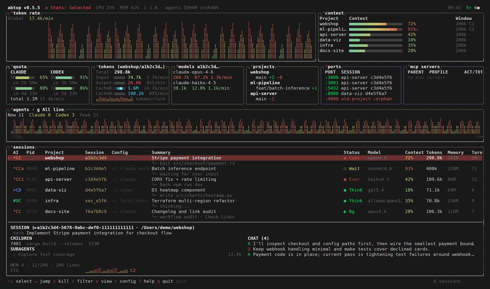
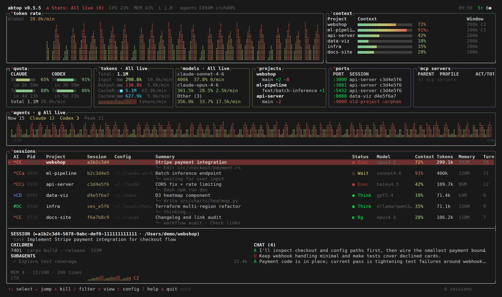
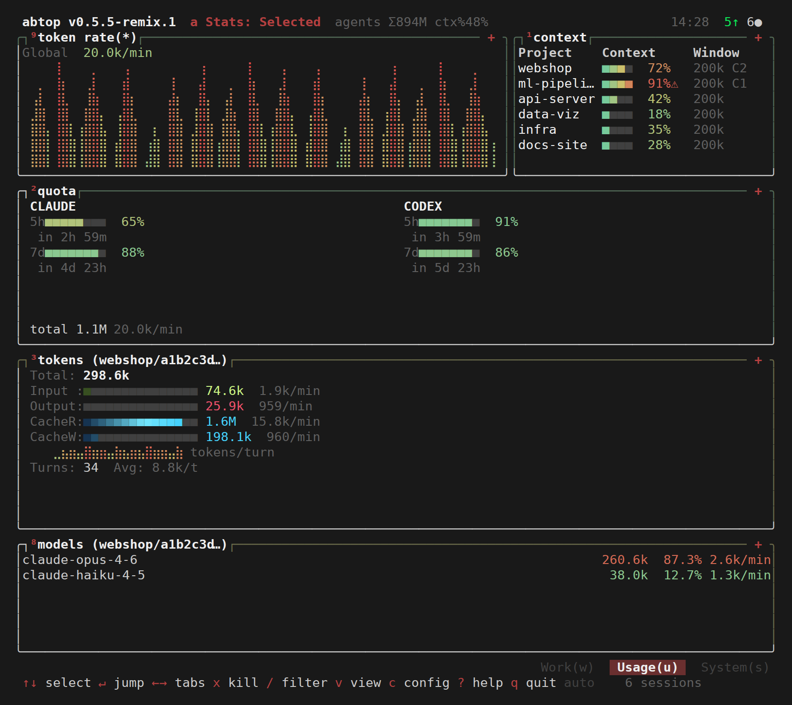
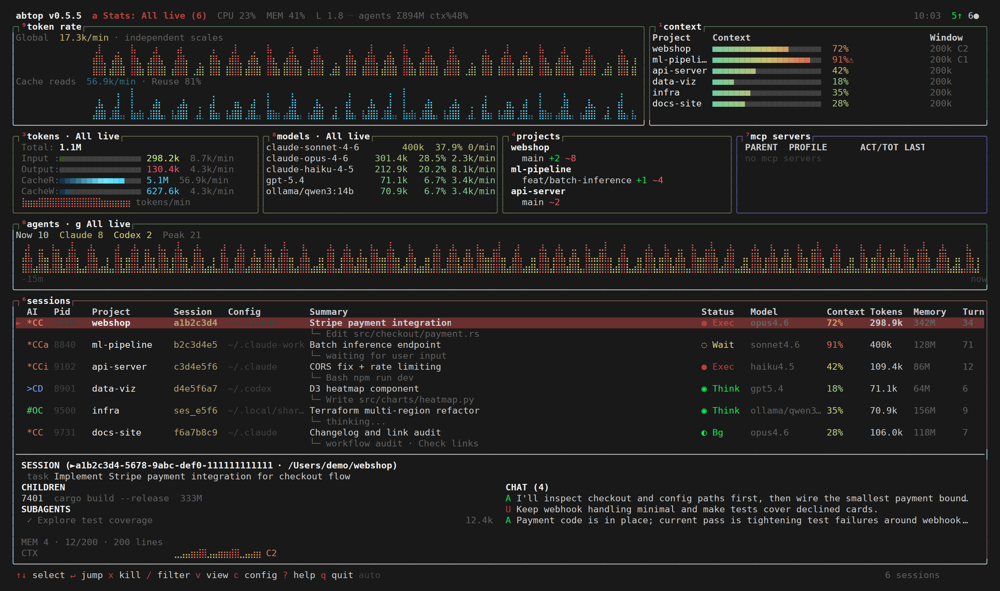

# Remix features

What the [`raphberube/abtop`](https://github.com/raphberube/abtop) fork adds on top of
upstream [`graykode/abtop`](https://github.com/graykode/abtop). The README's
[Remix features](../README.md#remix-features) section has the short version and screenshots.
Every screenshot comes from `abtop --demo` and is regenerated with
[`scripts/remix-screenshots.sh`](../scripts/remix-screenshots.sh).

| Pane or feature | Key | Config | Section |
|---|---|---|---|
| Agents concurrency chart | `0`, scope `g` | `show_agents`, `agent_scope` | [Agents](#agents-pane) |
| Context | `1` | `show_context` | [Token rate and Context](#token-rate-and-context-panes) |
| Models with per-model rates | `8` | `show_models` | [Models](#models-pane) |
| Token rate | `9` | `show_token_rate` | [Token rate and Context](#token-rate-and-context-panes) |
| Cache-read chart and Reuse % | `C` (Shift+C) | `show_cache_read_rate` | [Cache reads](#cache-read-chart-and-reuse-) |
| Tokens and Models scope | `a` | `stats_scope` | [Stats scope](#stats-scope-selected--all-live) |
| Per-category token rates | — | — | [Tokens](#tokens-pane-rates) |
| `◐ Bg` session status | — | — | [Background status](#background-session-status) |
| Progressive startup | — | — | [Startup](#progressive-startup) |
| Totals exclude cache reads | — | — | [Token accounting](#token-accounting) |

## Token accounting

Token totals use **input + output + cache writes**, excluding cache reads. This
basis applies to session and subagent totals, Tokens averages and per-turn
history, activity rates, Models attribution and shares, All live statistics, and
plain/JSON snapshots. Cache writes remain included.

The CacheR row is labeled `excluded` (or `excl` in compact layouts) because it is
excluded from Total. It remains a separate raw counter, including when Total is
zero; Models shows an explicit empty state when no qualifying usage exists.
Category bars show each category's share of **all four raw categories**, including cache reads; they are
not shares of the headline Total. Cached context still occupies the context
window, and account quotas retain their provider-defined meanings.

Excluding cache reads focuses headline totals on token categories that generally
cost more per token, making spending drivers easier to gauge. These totals are
not cost estimates: prices vary by model and category, and large cache-read
volumes can still contribute materially to the bill. Cache reads remain visible
separately.

## Tokens pane rates

The tokens pane shows the selected session's Input, Output, CacheR, and CacheW totals, followed by tokens per minute over a rolling 60-second window. Claude totals and rates include subagents, including nested workflow agents. Rates count increases observed while abtop runs, start at zero, and return to zero after a minute without new tokens. On narrow panes, meter bars shrink first; rates are hidden if the text still cannot fit.

## Models pane

The models pane shows lifetime token totals, percentage share, and tokens per minute for each model in the selected statistics scope, sorted by lifetime usage. The rate follows the percentage and sums Input + Output + CacheW, excluding CacheR, over a rolling 60-second window. Rates start at zero and count increases observed while abtop runs. It appears beside Tokens on wide terminals and in the Usage tab on narrow terminals. Press `8` to toggle it, or use the View/config menus; visibility is saved. Narrow panes use two-line entries, moving the rate to a third line only when the metrics do not fit. Overflow is combined into `Other (N)`, including its summed rate.

Model totals include input, output, and cache writes, excluding cache reads and matching the Tokens pane in either scope. Distinct model versions stay separate, and OpenCode entries include the provider. Missing model metadata is counted as `Unknown`. Codex attributes increases in cumulative usage to the current turn's model; if counters decrease, the replacement baseline becomes `Unknown` and subsequent increases resume model attribution.

## Stats scope: Selected / All live

Press `a` to switch Tokens and Models together between **Selected** and **All live**. The header shows the current scope and live-session count; with `--mouse`, click that control to switch. The same action is available in the View menu (`v`). The initial scope is Selected, and your last choice is saved across restarts.

All live adds the lifetime usage of all confirmed live sessions from enabled collectors, including sessions waiting for input or rate limits. Finished sessions and sessions whose process ownership is unknown are excluded. Totals decrease when a session closes. Searching and selecting sessions only affects session navigation and details; it does not change All live totals. Quota remains account-level, and Context keeps its existing cross-session activity and per-session percentages.

Aggregate model shares use the combined token total, and average tokens per turn is the combined total divided by the combined turn count. The aggregate Tokens sparkline shows combined rolling `tokens/min`, excluding cache reads, sampled on each refresh for the sessions live at that time (up to 200 samples). History is collected even in Selected mode; discovering a session does not turn its past usage into a rate spike. Existing collector accounting is preserved: Claude session totals already include tracked subagents, while Codex and OpenCode totals cover each session itself.

## Token rate and Context panes

The top row has two independent panes: **Token rate** (`9`) shows the global token activity chart and tokens/min; **Context** (`1`) shows each session's project name, context usage, window size, and compaction count. Token rate counts input, output, and cache creation across collected sessions, excluding cache reads. It stays global regardless of selection or the Tokens/Models scope toggle. On desktop, the panes share the row at 65%/35%; hiding either lets the other use the full width. Both toggles are available in the View menu and configuration overlay and persist across restarts.

If `show_token_rate` is omitted, it inherits `show_context` (which defaults to `true`), preserving the old combined pane preference. Once saved, the two settings are independent.

## Cache-read chart and Reuse %

Press **`C` (Shift+C)** to add an optional **Cache reads/min** chart below the existing Token rate chart. It is disabled by default and can also be toggled in the View menu or configuration overlay. The two charts use independent vertical scales, so compare their numeric rates rather than their heights. Both plot synchronized per-refresh activity and retain up to 200 points, including while hidden. Short panes keep a cache-rate and reuse summary when the second chart cannot fit; `9` still controls the whole pane.

Both rate labels use tokens observed during the preceding 60 seconds, based on elapsed time rather than a fixed number of refreshes. Startup usage is not extrapolated, and already-observed activity remains in the window until it expires even after a session closes. **Reuse %** is `100 × cache reads / (input + cache reads + cache writes)` over that same window; output is excluded, and `—` means there were no input-side tokens. This measures the share of reported input-side tokens served from cache. It is not a percentage of money saved: prices depend on the provider, model, and billing arrangement, and abtop does not estimate dollar costs.

## Agents pane

The **Agents** panel (`0`) sits above Sessions and charts the preceding 15 minutes of concurrent Claude Code and Codex agent work, including main sessions and subagents. Braille bars use the same rendering style as Token rate, with theme gradients distinguishing the two stacked providers; the legend shows current counts and the observed peak. Press `g` (or click the panel title with `--mouse`) to switch between **All live**, the default, and **Selected**. This scope is independent of Tokens/Models. Each actively working main session counts once, even without subagents. Its working descendants each count once as well: one working main session with two working subagents counts as three. Waiting and rate-limited main sessions do not contribute to the working count; their working children still do. Shell commands and workflow containers are excluded. The narrow Work tab supports the same panel and zoom controls. Short layouts retain its summary before hiding its chart.

A child counts as working during an unfinished work turn, including model generation and tool execution. Quiet periods do not automatically mark it done. Claude uses child transcripts, launch/completion records, and workflow journal starts, results, and failures; Codex uses child-thread relationships and turn start/completion/interruption events. A small **Unknown** count identifies incomplete lifecycle evidence. Discovery is best-effort and can lag a refresh; filesystem-only Codex children can take up to the 10-second discovery interval to appear. OpenCode subagent tracking is unavailable.

Agent history starts when abtop observes activity, continues while the pane is hidden, and remains in memory for 15 minutes. Closing a session lowers the current count without deleting its history. Each bar preserves a real simultaneous peak sample when the window is wider than the chart. History resets when abtop exits; it is not reconstructed from old transcripts. Token and model totals keep their existing accounting.

## Background session status

A Claude Code session whose turn has ended while a workflow or background agent is still
running shows `◐ Bg` instead of `◌ Wait`, so "waiting on its own work" no longer looks like
"waiting on you". abtop sets it when the latest `turn_duration` line reports
`pendingWorkflowCount` or `pendingBackgroundAgentCount` above zero, or when a subagent or
workflow agent is still working (the same lifecycle the Agents pane uses). The task line names
the work: `workflow <name> · <working agent>`, `waiting on N workflows`,
`background agent <name>`, or `waiting on N agents`.

A Background root does not count toward the Agents pane; its working children do. Background
Bash (`run_in_background`) and Monitor tasks are not tracked, so a session waiting only on those
still shows `◌ Wait`. Codex and OpenCode never report `◐ Bg`. The on-disk signals and their
caveats are in [claude-code-background-work.md](claude-code-background-work.md).

## Progressive startup

The TUI opens immediately and collects sessions on a background thread. Each session appears
as soon as its transcript is parsed instead of after every collector finishes, and the first
complete snapshot replaces these provisional rows. Regular refreshes start once that snapshot
arrives.

## Responsive layout

The desktop layout reserves minimum widths for enabled panes and switches to tabs when they cannot fit (134 columns with all panes enabled). In the Usage tab, Token rate hides first, then Context, when height is limited, preserving both quota windows and all four token categories. Quota bars shrink before values are clipped, reset countdowns move inline in shorter panes, and Models combines overflow when needed. These automatic layout changes do not alter saved visibility settings.

Hidden panes free their width for the rest of the row. Here Quota (`2`) and Ports (`5`) are off, the cache-read chart (`C`) is on, and Tokens and Models use the All live scope (`a`):

## JSON snapshots and library API

For library consumers,
`AgentSession::total_tokens()` is the single total API; `active_tokens()` has been
removed. Snapshot field names and raw category counters are unchanged.

Each JSON session includes `model_usage`, an array of `{ "model": "...", "total_tokens": 123 }` entries sorted by usage. These entries use the same accounting and subagent scope as that session's `total_tokens`; percentage share is `100 * total_tokens / session.total_tokens` when the session total is nonzero. Library users constructing `AgentSession`, `SessionView`, or `PanelVisibility` literals must supply the new `model_usage` or `models` field as appropriate.

Stats scope affects the TUI only; `--once` and JSON snapshots retain their per-session output. Library users constructing `AppConfig` literals must supply `stats_scope` (or use `..Default::default()`). Existing `App` constructors default to `StatsScope::Selected`; set `app.stats_scope` explicitly to use another scope when rendering the TUI.

JSON snapshots add `subagent_counts` to each session (`working`, `unknown`) and to the top level (separate `claude` and `codex` counts). These remain child-only counts. The top-level `agent_counts` field includes working main sessions and their working children, matching the Agents chart. Both are complete current counts, independent of UI scope and the capped subagent detail list; history is not exported. A one-shot snapshot may precede background discovery of Codex children without open file descriptors.
